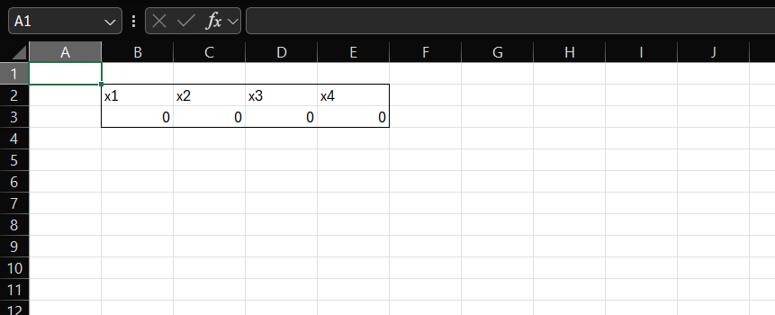
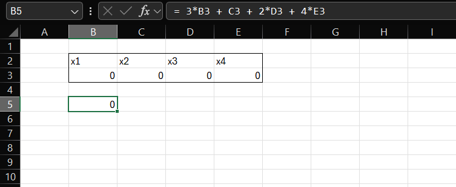
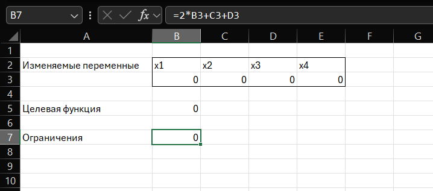
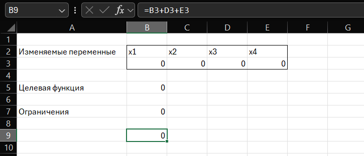
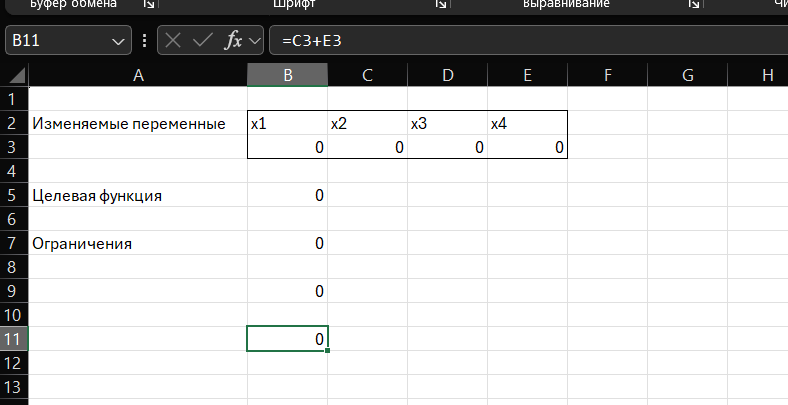
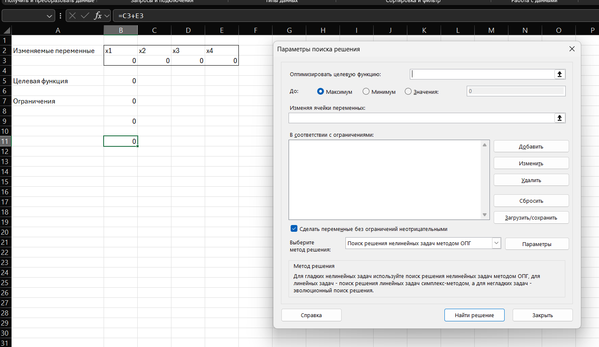
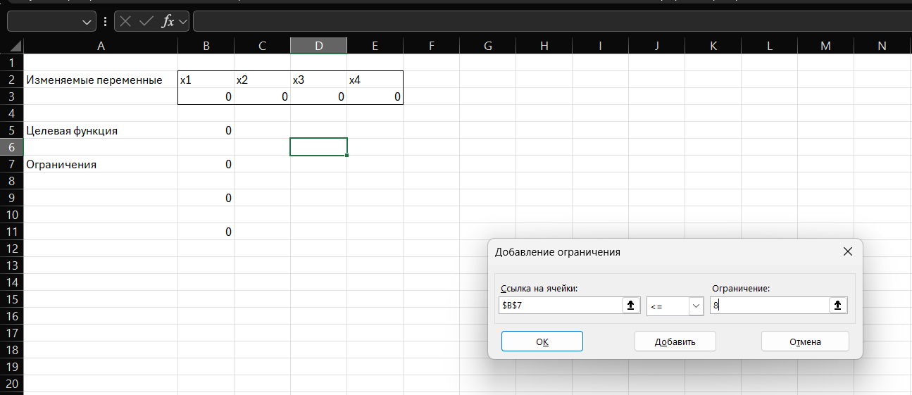
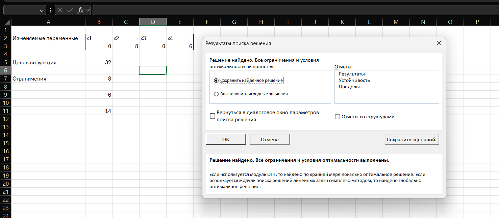

---
Выполнил: Чекалкин Семён, 427210
Поток: МетОпт 1.2
Вариант: 13

---
1. Создать ячейки изменяемых переменных: в ячейки B2:E2 написать заголовки x1, x2, x3, x4, в B3:E3 оставить значения ноль, сюда Solver запишет найденные значения

---
2.  В ячейке B5 ввести формулу целевой функции через ссылки на ячейки переменных: =3 * B3 + 1 * C3 + 2 * D3 + 4 * E3.

---
3. В трёх отдельных ячейках B7, B9, B11 записать формулы для каждого ограничения: 
- B7: =2 * B3 + C3 + D3 (для $\leq$ 8) 
- B9: =B3 + D3 + E3 (для = 6)
- B11: =C3 + E3 (для $\geq$ 4)

---
4. Открыть Данные &#8594 Поиск решения. Заполнить поля: 
- «Оптимизировать целевую функцию» - указать ячейку B5
- Переключатель поставить на «Максимум» 
- «Изменяя ячейки переменных» - выделить B3:E3
- Метод решения выберите «Поиск решения нелинейных задач методом ОПГ»
- В поле "В соотвествии с ограничениями" кнопкой "Добавить" добавить ограничения. В диалоговом окне "Добавление ограничения" указать ссылку на ячейку с ограничением, знак и значение ограничения
- Поставить галочку «Сделать переменные без ограничений неотрицательными» (задаёт условие x1,...,x4 $\geq$ 0)

---
5. Нажать «Найти решение». Solver заполнит ячейки B3:E3 оптимальными значениями переменных, а в B5 появится максимальное значение Z. 

 
 
---

Полученный при помощи Solver ответ соответствует ручному ответу: x1=0, x2=8, x3=0, x4=6, Z=32.